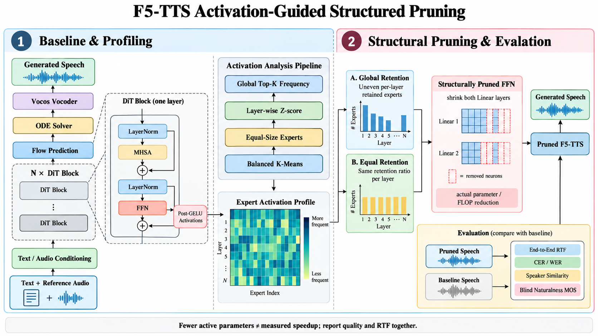

# F5-TTS Activation Pruning

这是一个基于 F5-TTS v1 的结构化剪枝实验。具体做法是：先统计 DiT 中 FFN 神经元的激活情况，再按统计结果缩小 FFN 的两层线性矩阵，最后在同一台 GPU 上测端到端 RTF。

项目目前已经跑通官方预训练模型、激活 profile、global/equal/random 三种裁剪和保留率扫描。微调、WER 和人工 MOS 还没有完成，因此下面只报告已经实际测过的参数量和速度。



图中左侧是 F5-TTS 推理与激活采集，中间是专家划分和保留策略，右侧是结构化裁剪后的推理评测。它描述的是本仓库的实现，不是 F5-TTS 原论文中的实验结果。

## 实验结果

测试环境：RTX 4060 Laptop GPU、Python 3.11.11、PyTorch 2.6.0+cu124、CUDA 12.4、F5-TTS v1 Base、Vocos、NFE 32。每组先预热 1 次，再把 10 条验证文本完整运行 3 轮。RTF 包含文本处理、声学模型、Vocos 和 WAV 写盘，不包含模型加载。

| 配置 | FFN 实际保留率 | 总参数量 | 参数减少 | RTF（3 轮均值 ± 标准差） | 相对基线加速 |
|---|---:|---:|---:|---:|---:|
| 未裁剪基线 | 100% | 337,096,804 | 0% | 0.307948 ± 0.002683 | 1.000× |
| global-90 | 89.99% | 327,851,716 | 2.743% | 0.300732 ± 0.000436 | 1.024× |
| global-80 | 79.97% | 318,606,628 | 5.485% | 0.293995 ± 0.000737 | 1.047× |
| global-70 | 70.03% | 309,427,108 | 8.208% | 0.286624 ± 0.001598 | 1.074× |
| random-80 | 79.97% | 318,606,628 | 5.485% | 0.294057 ± 0.001029 | 1.047× |
| equal-80 | 79.69% | 318,344,356 | 5.563% | 0.297101 ± 0.003921 | 1.037× |

global 的保留率从 90% 降到 70% 时，参数量和 RTF 都单调下降。global-70 的端到端 RTF 比未裁剪基线低 6.92%，对应约 1.074 倍吞吐加速。

global-80 和 random-80 使用完全相同的逐层宽度，所以参数量与速度接近是正常的。两者真正要比较的是语音质量：如果激活排序有效，global 应该在 WER、音色或自然度上优于随机选择。当前尚未完成这部分评测，不能仅凭 RTF 宣称 global 优于 random。

另有一组 15 条测试文本的未裁剪基线，RTF 为 `0.304825 ± 0.000950`。它没有参与保留率选择。完整记录见 [docs/RESULTS.md](docs/RESULTS.md)，计时和数据划分见 [docs/PROTOCOL.md](docs/PROTOCOL.md)。

## 裁剪方法

F5-TTS v1 Base 的 DiT 包含 22 个 FFN block，每层中间维度为 2048。本项目在每层做以下处理：

1. 根据第一层线性投影的权重方向，把 2048 个神经元平衡划分成 64 个专家，每个专家包含 32 个神经元。
2. 在独立的 profile 文本上记录 post-GELU 激活，统计每个专家的活跃频率。
3. 根据策略选择要保留的专家。
4. 同时裁掉 FFN 输入投影的输出行和输出投影的输入列，生成更小的真实矩阵。

三种策略的用途不同：

- `global`：把所有层的专家放在一起排序，允许不同层保留不同宽度。
- `equal`：每层保留相同比例，用来判断跨层非均匀分配是否有作用。
- `random`：沿用 global 的逐层宽度，但随机选择层内专家，用来判断激活排序是否优于随机选择。

这里做的是 profile 后的静态结构化裁剪，不是推理时动态 MoE。代码实际缩小矩阵，不使用零掩码代替加速。

## 数据划分

仓库里的英文车载文本分成三份：

| 文件 | 数量 | 用途 |
|---|---:|---|
| `data/profile_texts_en.jsonl` | 15 | 收集专家激活，只生成一次 profile |
| `data/validation_texts_en.jsonl` | 10 | 比较保留率和裁剪策略 |
| `data/eval_texts_en.jsonl` | 15 | 配置确定后的最终测试 |

profile、validation 和 eval 不能混用。最终测试集不应被拿来反复选择保留率。

清单默认引用 `data/private/basic_ref_en.wav`。该参考音频以及模型权重不提交到仓库，需要自行准备。

## 安装

已经验证的本机环境是 Windows、Python 3.11 和 CUDA 12.4。详细安装过程见 [docs/BASELINE_SETUP.md](docs/BASELINE_SETUP.md)。安装项目本身：

```powershell
python -m pip install -e ".[tts,test]"
python -m pytest -q
```

本次实验使用的本地文件结构：

```text
checkpoints/
  F5TTS_v1_Base/
    model_1250000.safetensors
    vocab.txt
  vocos-mel-24khz/
data/private/
  basic_ref_en.wav
```

在 PowerShell 中先设置路径：

```powershell
$ckpt = (Resolve-Path "checkpoints\F5TTS_v1_Base\model_1250000.safetensors").Path
$vocab = (Resolve-Path "checkpoints\F5TTS_v1_Base\vocab.txt").Path
$vocoder = (Resolve-Path "checkpoints\vocos-mel-24khz").Path
```

## 复现实验

### 1. 未裁剪验证基线

```powershell
car-tts benchmark `
  "data\validation_texts_en.jsonl" `
  "outputs\validation-baseline" `
  --checkpoint "$ckpt" `
  --vocab "$vocab" `
  --vocoder "$vocoder" `
  --warmup 1 `
  --repeats 3 `
  --nfe-step 32 `
  --seed 42 `
  --device cuda
```

结果保存在 `outputs/validation-baseline/benchmark.json`，里面包含三轮汇总、逐条 latency、音频时长和运行环境。

### 2. 收集专家激活

```powershell
python scripts\profile_experts.py `
  "data\profile_texts_en.jsonl" `
  "artifacts\expert_profile_en.json" `
  --model F5TTS_v1_Base `
  --checkpoint "$ckpt" `
  --vocab "$vocab" `
  --vocoder "$vocoder" `
  --experts 64 `
  --top-fraction 0.20 `
  --nfe-step 32 `
  --seed 42 `
  --device cuda
```

后续所有策略和保留率共用这个 profile，不要分别重新采集。

### 3. 运行 80% 三策略对照

```powershell
foreach ($strategy in @("global", "random", "equal")) {
    python scripts\prune_benchmark.py `
      "artifacts\expert_profile_en.json" `
      "data\validation_texts_en.jsonl" `
      "outputs\validation-$strategy-80" `
      --model F5TTS_v1_Base `
      --checkpoint "$ckpt" `
      --vocab "$vocab" `
      --vocoder "$vocoder" `
      --retain 0.8 `
      --strategy $strategy `
      --warmup 1 `
      --repeats 3 `
      --nfe-step 32 `
      --seed 42 `
      --device cuda
}
```

每个目录都会生成 `prune_benchmark.json`、`expert_masks.json` 和对应 WAV。

### 4. 扫描 global 保留率

```powershell
foreach ($retain in @(0.9, 0.7)) {
    $tag = [int]($retain * 100)

    python scripts\prune_benchmark.py `
      "artifacts\expert_profile_en.json" `
      "data\validation_texts_en.jsonl" `
      "outputs\validation-global-$tag" `
      --model F5TTS_v1_Base `
      --checkpoint "$ckpt" `
      --vocab "$vocab" `
      --vocoder "$vocoder" `
      --retain $retain `
      --strategy global `
      --warmup 1 `
      --repeats 3 `
      --nfe-step 32 `
      --seed 42 `
      --device cuda
}
```

## 数据准备与微调

自己的语音数据使用 JSONL 清单管理：

```json
{"id":"speaker01_0001","audio":"private/wavs/0001.wav","text":"今天天气很好。","speaker":"speaker01","source_recording":"session01"}
```

```powershell
car-tts prepare data\my_manifest.jsonl artifacts\dataset --seed 42
```

数据准备会检查路径、时长和重复项，并按 `speaker/source_recording` 分组划分，减少同一录音切片跨集合泄漏。它不能代替人工检查转写、静音、爆音、截断和授权。

F5-TTS 微调入口封装在 `scripts/finetune.ps1`。目前仓库没有提交微调 checkpoint，也没有把未运行的微调结果写进表格。

## MOS 工具

仓库提供了简单的匿名化和评分汇总命令：

```powershell
car-tts mos-create `
  --system baseline=artifacts/mos/baseline.jsonl `
  --system pruned=artifacts/mos/pruned.jsonl `
  --output artifacts/mos/trials.jsonl `
  --seed 42

car-tts mos-aggregate artifacts/mos/ratings.csv artifacts/mos/trials.jsonl
```

这只是记录和汇总工具，不代表当前已经完成 MOS。正式结论还需要足够的听者、随机顺序、统一播放条件和原始评分记录。

## 目录

```text
src/car_tts/
  backend.py       F5-TTS 推理封装
  benchmark.py     RTF 计时与结果记录
  dataset.py       数据检查和分组划分
  experts.py       专家聚类、激活统计和结构化裁剪
  mos.py           盲听清单与评分汇总
scripts/
  profile_experts.py
  prune_benchmark.py
  finetune.ps1
docs/
  BASELINE_SETUP.md
  PROTOCOL.md
  RESULTS.md
```

## 当前缺项

- baseline/global/random/equal 的自动 WER 或 CER。
- 说话人相似度评测。
- 人工自然度 MOS。
- 真实语音微调 checkpoint 和训练日志。
- 配置锁定后的最终测试集裁剪结果。

在这些项目完成前，当前结果只能支持“结构化裁剪降低了参数量和端到端 RTF”，还不能支持“语音质量基本不变”或“激活选择优于随机选择”。

## 参考

- Yushen Chen et al. [F5-TTS: A Fairytaler that Fakes Fluent and Faithful Speech with Flow Matching](https://aclanthology.org/2025.acl-long.313/). ACL 2025.
- Chuan Wu et al. *Unveiling Multimodal Processing: Exploring Activation Patterns in Multimodal LLMs for Interpretability and Efficiency*. Findings of EMNLP 2025.
- [SWivid/F5-TTS](https://github.com/SWivid/F5-TTS)

本仓库不包含 F5-TTS 模型权重和上游源码。
